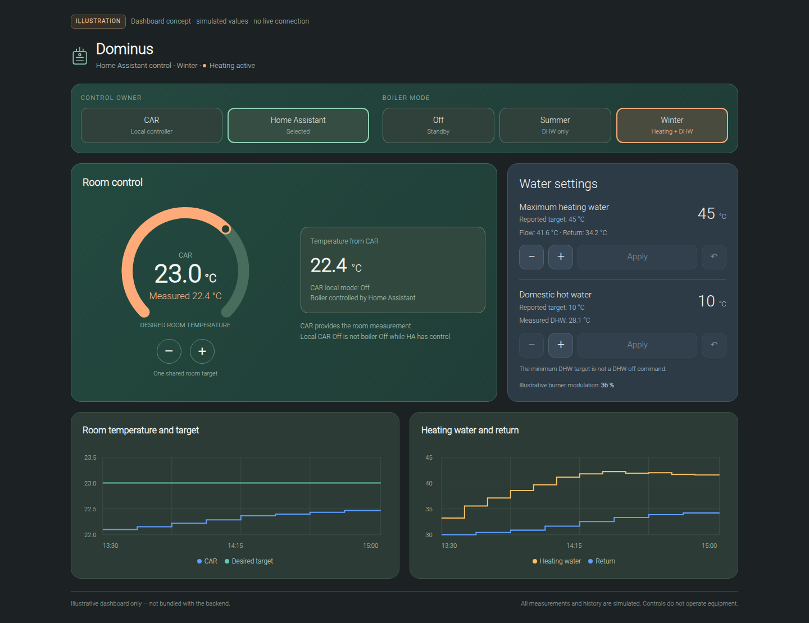

# Immergas Dominus EXA

Unofficial Home Assistant integration for the **6-byte EXA protocol**, using an
existing Dominus module and CAR controller. **Not compatible with the Magis Modbus map.**

**Unpublished experimental release candidate.** Not distributed through HACS.
MIT licensed; validation and final publication review remain required before a public beta release.

## Features

- Local telemetry: room, heating-water, return and DHW temperatures; targets,
  burner modulation, heating/DHW activity and reported flame.
- Explicit CAR / HA ownership and OFF / Summer / Winter controls.
- Shared room target using the temperature reported by CAR.
- Adjustable heating-water maximum and DHW target in every HA operating mode.
- English/Czech entity labels and redacted diagnostics.

## Dashboard preview

Illustrative design with **simulated data**, not a live HA screenshot or a dashboard
installed by this integration. The native YAML example below is a separate, simpler UI.



[Mobile illustration](docs/images/dashboard-mobile.png) · [Offline HTML concept](examples/dashboard-concept.html)

## Installation

[Network setup and first use: English](docs/getting-started.en.md) · [Česky](docs/getting-started.cs.md)

1. Copy `custom_components/immergas_dominus_exa` into your HA
   `/config/custom_components/` directory and restart Home Assistant.
2. Add **Immergas Dominus EXA** under **Settings → Devices & services**.
3. Enter the module's LAN address, MAC and optional password.
4. Select **CAR** as the room measurement source. **Control permissions default to OFF**;
   commission them deliberately using the [configuration guide](docs/configuration.md).

An optional [dashboard example](examples/dashboard.yaml) uses placeholder entity IDs.
The installation's private dashboard and visual configuration are not included.

## Important limits

- Saving a water setting never starts heating or changes the operating mode.
  **Summer permits DHW only; Winter permits radiators and DHW.** In OFF, a DHW
  request is saved in HA and applied only after an explicit Summer/Winter selection.
- No automatic takeover or heating restoration at startup, reload or reconnect.
  Invalid inputs stop further control writes, **not necessarily the boiler**.
  This integration is not a safety interlock or a guaranteed fallback controller.
- Room compensation requires the existing native room sensor and modulation to
  be enabled. It translates a target; it does not inject a measured temperature.
- HA keeps a persistent connection, including in read-only mode. Simultaneous use
  of the official mobile app may be unavailable.
- Antifreeze commands, cooling, independent DHW-off and service/reset controls are
  not implemented. Long-term stability and all outage scenarios are not validated.

## Documentation

- [Configuration, controls and safety](docs/configuration.md)
- **Unpublished beta draft**: [Česky](docs/releases/beta-draft.cs.md) · [English](docs/releases/beta-draft.en.md)

## License and acknowledgements

[MIT](LICENSE) © 2026 pajikcz. See [third-party notices](THIRD_PARTY_NOTICES.md)
for JoTu's upstream MIT notice and protocol-source acknowledgements.
Not affiliated with or endorsed by Immergas; manufacturer materials and trademarks
are not licensed by this project.

## Development

Offline checks, without connecting to HA or a boiler:

```sh
python3 -m unittest discover -s tests
```

Keep credentials and private configuration out of this repository. Do not expose
Dominus TCP port 2000 publicly; device identification is not transport encryption.
